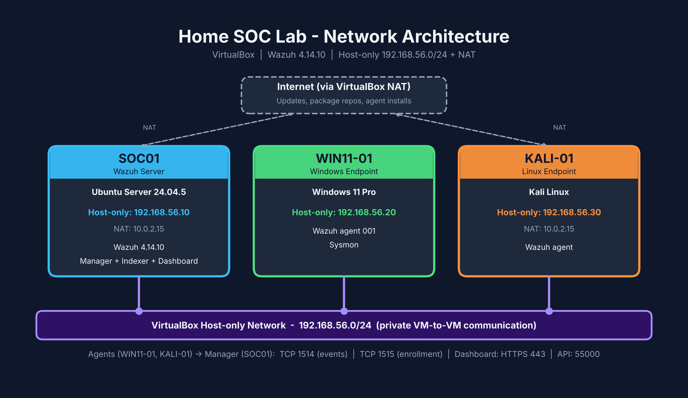
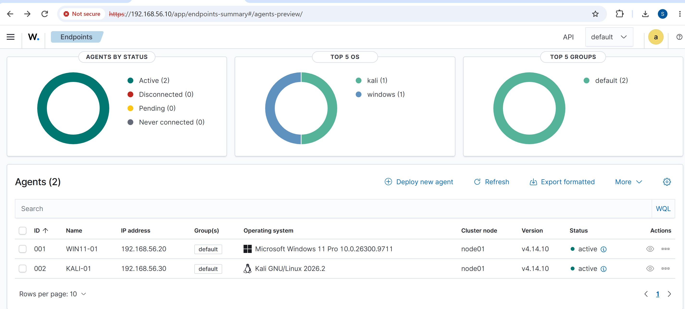
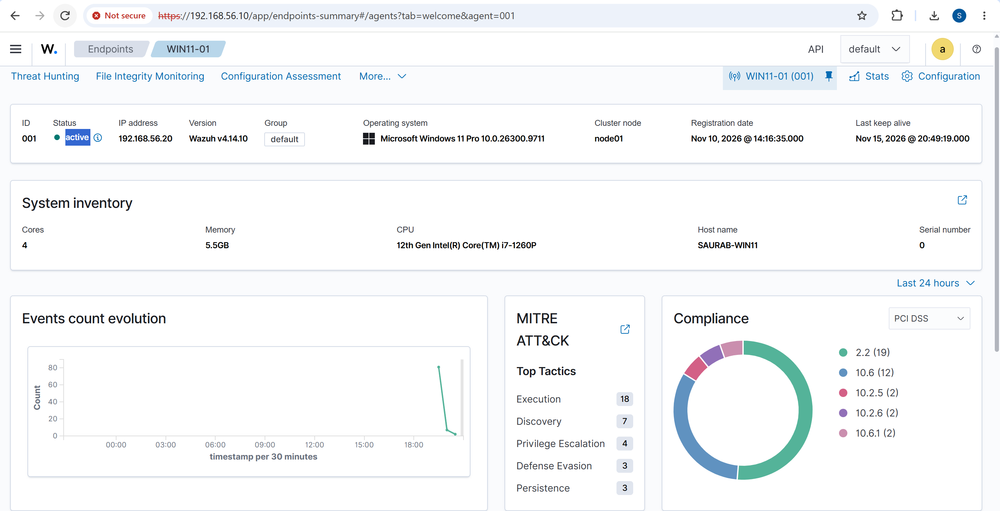
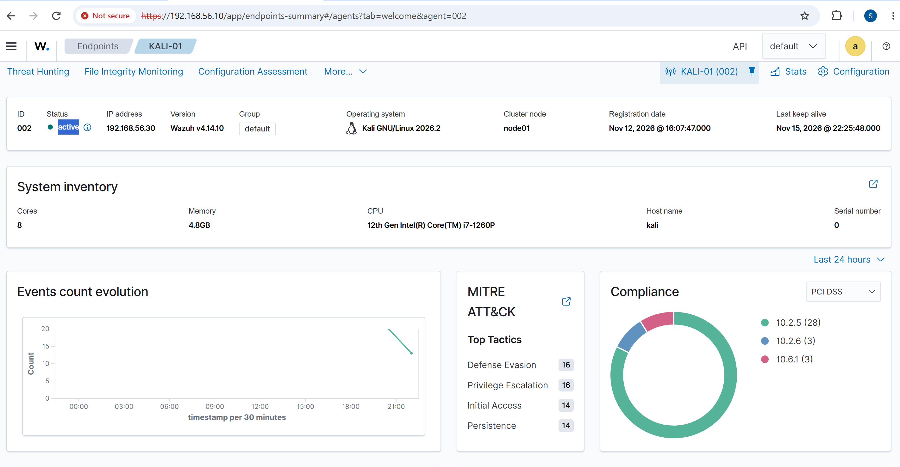
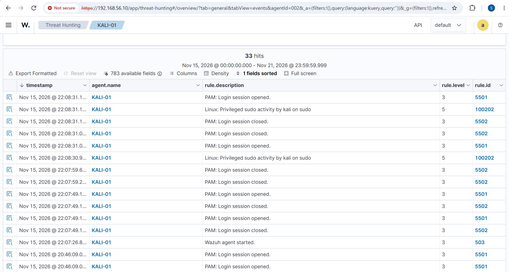
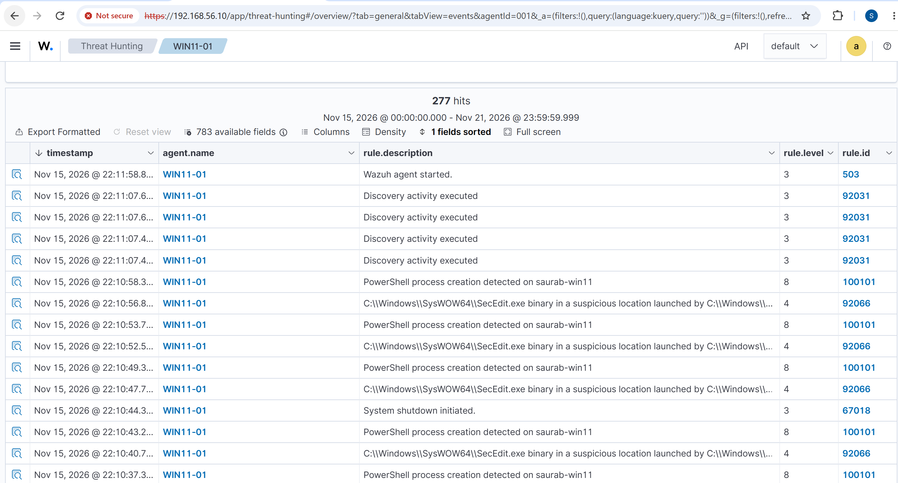

\# Home SOC Lab – Wazuh SIEM

\## Project Overview

This project documents the design, deployment and testing of a

virtualised Security Operations Centre (SOC) home lab using Wazuh.

The lab was developed to gain practical experience in security

monitoring, endpoint detection, log analysis, file integrity

monitoring, detection engineering and incident investigation.

The environment uses isolated virtual machines to simulate

a small enterprise security monitoring environment.

\## Objectives

\- Deploy and configure a centralised Wazuh SIEM platform.

\- Monitor Windows and Linux endpoints.

\- Collect and analyse endpoint security events.

\- Integrate Sysmon for Windows process monitoring.

\- Configure and test security detection rules.

\- Investigate suspicious and security-related activities.

\- Implement and validate File Integrity Monitoring (FIM).

\- Map relevant detections to MITRE ATT\&CK.

\- Document investigation findings and recommendations.

\## Lab Architecture

| Component | Operating System | Role |

|---|---|---|

| SOC01 | Ubuntu Server 24.04 | Wazuh SIEM server |

| WIN11-01 | Windows 11 Pro | Monitored Windows endpoint |

| KALI-01 | Kali Linux | Monitored Linux endpoint |

\### Network Configuration

| Machine | Host-only IP |

|---|---|

| SOC01 | 192.168.56.10 |

| WIN11-01 | 192.168.56.20 |

| KALI-01 | 192.168.56.30 |

The lab uses Oracle VirtualBox with NAT and host-only networking.

The host-only network provides communication between the lab

machines while keeping endpoint testing separate from the

personal Windows host.

\## Technologies Used

\- Wazuh SIEM

\- Ubuntu Server

\- Windows 11

\- Kali Linux

\- Sysmon

\- Oracle VirtualBox

\- PowerShell

\- Bash

\- XML

\- Git and GitHub

\- MITRE ATT\&CK Framework

## Lab Architecture

The following diagram illustrates the virtualised SOC environment, including the Wazuh server and monitored endpoints connected through the VirtualBox host-only network.

## Security Monitoring Dashboard

The Wazuh dashboard provides centralised visibility into monitored endpoints, security events, and generated alerts.

## Endpoint Integration and Monitoring

The lab integrates Windows 11 and Kali Linux endpoints with the central Wazuh manager.

### Windows Endpoint

The Windows endpoint is registered with Wazuh and uses Sysmon to provide additional process-creation telemetry.

### Kali Linux Endpoint

The Kali Linux endpoint is integrated with the Wazuh manager for Linux security event monitoring.

## Detection and Alert Validation

Custom Wazuh detection rules were implemented to identify selected Windows and Linux security events.

### Linux Detection

### Windows Detection

## Additional Technical Evidence

Further evidence covering Wazuh service status, Sysmon event collection, and detailed detection events is available in the [evidence directory](evidence/).

\## Implemented Capabilities

Document only capabilities that have been successfully

configured and tested.

\- Centralised endpoint monitoring.

\- Windows event collection.

\- Sysmon event collection.

\- Linux security log collection.

\- Custom detection rules.

\- File Integrity Monitoring.

\- Security event investigation.

\- MITRE ATT\&CK technique mapping.

\## Detection and Investigation

The lab includes controlled security tests covering areas such as:

\- Windows failed authentication attempts.

\- PowerShell process execution.

\- Linux SSH authentication failures.

\- Privileged activity.

\- File integrity changes.

Each investigation documents the activity, collected events,

detection results, analysis and recommended response.

\## Repository Structure

\- `architecture/` – Lab architecture and network documentation.

\- `installation/` – Installation and deployment guides.

\- `configurations/` – Sanitised configuration examples.

\- `detection-rules/` – Custom detection rules.

\- `detection-testing/` – Test cases and validation results.

\- `incident-reports/` – Security investigation reports.

\- `evidence/` – Selected supporting evidence.

\- `reports/` – Overall project documentation.

\## Security and Ethical Considerations

\- Security testing was conducted in an isolated virtual lab.

\- No testing was intentionally performed against external systems.

\- Sensitive credentials, private keys and passwords are excluded.

\- Configuration examples are sanitised before publication.

\## Project Purpose

This project demonstrates practical learning in SIEM deployment,

endpoint monitoring, security event analysis, detection engineering

and incident investigation.

It is intended for educational and defensive cybersecurity

portfolio purposes.

